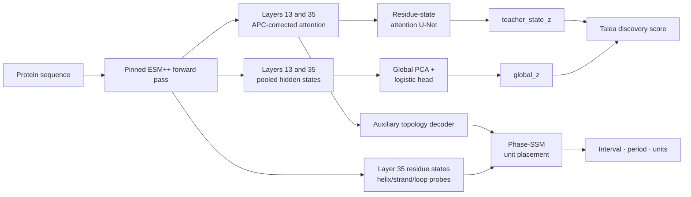

<p align="center">
  
</p>

# Talea

[](https://github.com/jwestrob/Talea/actions/workflows/tests.yml)


**Sequence-only discovery of elongated protein-solenoid architecture from
protein-language-model attention.**

Talea ranks proteins for solenoid-like structural repetition directly from
amino-acid sequence. It requires no experimental structure, predicted
structure, multiple-sequence alignment, or database search at inference time.
Alongside its primary protein-level score, Talea reports candidate repeat
intervals, periods, and registered units from the same model pass.

The name *talea* refers to the repeating rhythmic pattern in medieval
isorhythm: a recurring temporal unit that may persist beneath a changing
melodic surface. That is a pleasingly close analogy for divergent protein
sequences preserving an underlying repeated geometry.

## At a glance

| | |
|---|---|
| **Input** | Protein FASTA |
| **Primary output** | Continuous score for elongated/open solenoid-like architecture |
| **Localization output** | Candidate interval, period, and registered repeat units |
| **Structure required at inference** | No |
| **Alignment required** | No |
| **Maximum frozen length** | 2,046 aa |
| **Accepted residues** | The 20 canonical amino acids only |
| **Current status** | Research software; ranking model, not a curated annotation caller |

> [!NOTE]
> Talea deliberately has no hard positive/negative threshold. Its primary
> output is a ranking score for discovery and follow-up, not a definitive
> structural or biological annotation.

## Why Talea?

Protein solenoids are built from repeated structural units, but the sequence
identity between units can be weak or effectively absent. Sequence-repeat
finders therefore miss many structurally repetitive proteins, while
structure-based tools first require an experimental model or a successful
structure prediction. The latter can be expensive at metagenomic scale and
can be unreliable for unusual, long, oligomeric, or context-dependent
proteins.

Protein-language-model attention offers another view. Repeated structural
relationships can produce periodic, translated patterns in attention space
even when conventional sequence alignment is uninformative. Talea reads both
that local geometry and the protein's global language-model representation.
It is intended as a fast triage layer: identify the sequences most worth
folding, inspecting, or testing with structure-aware methods.

“Sequence-only” describes inference. Structural annotations were used during
model development and evaluation.

## How Talea works



One ESM++ pass supplies both branches:

1. **Residue-state branch.** Attention from zero-based transformer layers 13
   and 35 is symmetrized, average-product corrected, rectified, and averaged
   across heads. A compact two-dimensional U-Net reads the two attention
   channels plus a valid pair mask in 128 residue tiles.
   Predictions are reconstructed from each tile's central 64-residue diagonal.
   The mean elongated-state probability is logit-transformed and standardized
   against frozen development controls.
2. **Global branch.** Residue-wise means and population standard deviations of
   hidden states from the same two layers are passed through a frozen
   standardization, whitened 64-component PCA, and sample-weighted logistic
   head.
   Its probability is likewise logit-transformed and standardized against
   frozen controls.
3. **Auxiliary topology branch.** Multi-scale attention spectra propose repeat
   periods and intervals. Talea then registers translated units and evaluates
   terminal closure and plausible boundaries. These outputs support
   localization and interpretation but do not enter the primary v2 rank.
4. **Unit placement.** Within the registered extent, Talea 0.2.0 places repeat
   units with a phase-aware state-space decoder. Three linear probes on the
   layer-35 hidden states give per-residue helix, strand, and loop
   probabilities. Demodulating each track at the registered period gives every
   residue a vote for its position within a unit. A hidden semi-Markov model
   then decodes units of locally varying length (0.6–1.6 × period) whose phase
   agrees with the votes and whose length is supported by attention stacking.
   Scores, the wedge interval, the period, closure, and the boundary scan are
   computed before this step and are exactly those of v0.1.0.

The frozen primary score is the unweighted mean of the two independently
standardized protein views:

```text
Talea_discovery = 0.5 × teacher_state_z + 0.5 × global_z
```

No coefficient in this fusion was fit to the evaluation cohort. The 50:50
formulation was nevertheless selected after that cohort had been opened; see
[What “post-opening” means here](#what-post-opening-means-here).

### Why layers 13 and 35?

Layer indices are zero-based transformer-block indices. All 36 ESM++ layers
were compared under the same attention-harmonic formulation on a canonical
development cohort of 127 positives and 126 length-matched controls:

- layer 13 had the highest development AUROC: 0.663, with AP 0.658;
- layer 35 had the highest development AP: 0.688, with AUROC 0.651.

The pair therefore preserves the best layer under each pre-existing metric
without a combinatorial layer-pair search. The choice was made before the
452-protein comparator cohort existed and remained fixed thereafter. Blindly
averaging the final eight layers performed substantially worse on the
homology-disjoint confirmation cohort.

## Installation

### Requirements

- Python 3.10 or newer
- PyTorch
- Transformers 4.57 or newer
- CUDA or Apple MPS strongly recommended

Clone and install in an isolated environment:

```bash
git clone https://github.com/jwestrob/Talea.git
cd Talea

python -m venv .venv
source .venv/bin/activate
python -m pip install --upgrade pip
python -m pip install -e .
```

The small Talea heads and calibrations are included in the package. The pinned
`Synthyra/ESMplusplus_large` checkpoint is not vendored. Its primary weight
file is approximately 2.3 GB and is downloaded into the normal Hugging Face
cache on first use.

Talea pins the ESM++ repository revision in its deployment contract. Loading
that model currently requires `--trust-remote-code`. After the exact revision
has been cached, `--local-files-only` prevents further network access.

## Command-line use

### Apple Silicon

```bash
talea \
  --input proteins.faa \
  --output predictions.jsonl \
  --device mps \
  --trust-remote-code
```

### CUDA

```bash
talea \
  --input proteins.faa \
  --output predictions.jsonl \
  --device cuda \
  --trust-remote-code
```

### Automatic device selection

```bash
talea \
  -i proteins.faa \
  -o predictions.jsonl \
  --device auto \
  --trust-remote-code
```

`auto` selects CUDA, then MPS, then CPU. CPU inference is supported but is
generally impractical for large screens.

Talea writes:

- one JSON object per protein to the requested JSONL file; and
- a sibling `<output>.audit.json` containing exact input, output, model,
  environment, and artifact checksums.

### CLI options

| Option | Meaning | Default |
|---|---|---:|
| `-i`, `--input` | Protein FASTA | required |
| `-o`, `--output` | Prediction JSONL | required |
| `--device` | `auto`, `cpu`, `mps`, `cuda`, or an explicit Torch device | `auto` |
| `--dtype` | `auto`, `fp16`, `fp32`, or `bf16` | `auto` |
| `--maximum-batch` | Maximum proteins per padded ESM++ batch | 64 |
| `--square-budget` | Upper bound on batch size × padded sequence length² | 4,000,000 |
| `--postprocess-workers` | CPU workers for topology decoding | all available CPUs (process mode); 1 (thread mode) |
| `--postprocess-mode` | `process` to scale across CPU cores, or `thread` to stay in one process | `process` |
| `--capture-mode` | `manual` (numerically identical to the frozen run) or `sdpa` (faster, small numerical drift) | `manual` |
| `--cache-clear-interval` | Release accelerator caches every N batches; 0 never does | 0 |
| `--deterministic` | Pin cuDNN to deterministic convolution algorithms | off |
| `--unit-placement` | `phase-ssm`, or `comb` for the v0.1.0 equal-period units | `phase-ssm` |
| `--long-proteins` | `reject` proteins above 2,046 aa, or score them as overlapping `window`s | `reject` |
| `--window-length` | Residues per window in window mode | 2,000 |
| `--window-stride` | Residues between window starts in window mode | 1,000 |
| `--trust-remote-code` | Permit the pinned ESM++ model implementation to load | off |
| `--local-files-only` | Use only the local Hugging Face cache | off |
| `--overwrite` | Replace an existing output and audit | off |
| `--quiet` | Suppress progress messages | off |
| `--version` | Print Talea's version | — |

Run `talea --help` for the live interface.

## Python API

```python
from talea.artifacts import load_deployment
from talea.inference import TaleaPredictor
from talea.io import read_fasta


def main():
    deployment = load_deployment()
    records = read_fasta(
        "proteins.faa",
        maximum_length=deployment["input_contract"]["maximum_residues"],
    )
    predictor = TaleaPredictor(
        device="cuda",
        dtype="fp16",
        trust_remote_code=True,
    )
    for prediction in predictor.iter_predictions(records, progress=True):
        print(
            prediction["record_id"],
            prediction["talea_discovery_score"],
            prediction["wedge_call"],
        )


if __name__ == "__main__":
    main()
```

Postprocessing runs in worker processes, and each worker re-imports the calling
script (Python's rule for spawned processes), so keep the entry point under
`if __name__ == "__main__":` as above. `postprocess_mode="thread"` runs in one
process.

`TaleaPredictor(unit_placement="comb")` reproduces v0.1.0 unit boundaries.
Load one `TaleaPredictor` and reuse it. Starting multiple processes on the same
GPU duplicates ESM++ and its attention buffers.

## Input contract

Talea validates the complete FASTA before loading ESM++.

- Only `ACDEFGHIKLMNPQRSTVWY` is accepted.
- A single terminal `*` is removed as a FASTA serialization marker.
- Internal stops, repeated terminal stops, ambiguity codes, and all other
  noncanonical characters are errors.
- Residues are never masked, imputed, or replaced.
- FASTA record identifiers—the first whitespace-delimited header token—must be
  unique.
- Empty sequences are errors.
- The frozen v2 maximum is 2,046 residues.
- Sequences longer than the evaluation maximum of 1,732 residues are accepted
  through 2,046 aa but explicitly marked as length extrapolations.

If any record violates the contract, the run stops before model inference.

Predictions are emitted in length-sorted order to reduce padded-attention
memory. Join outputs back to inputs by `record_id`, not line number.

## Output interpretation

All residue coordinates are zero-based and half-open: `start` is included and
`end` is excluded.

| Field | Interpretation |
|---|---|
| `record_id` | FASTA identifier |
| `sequence_sha256` | SHA256 of the exact normalized amino-acid sequence |
| `talea_discovery_score` | Primary stable v2 ranking score |
| `primary_score_field` | Explicit declaration of the field to rank |
| `teacher_state_probability` | Mean predicted elongated-state probability |
| `teacher_state_z` | Control-standardized logit of the state probability |
| `global_probability` | Frozen global-head probability |
| `global_z` | Control-standardized logit of the global probability |
| `topology_development_control_z` | Auxiliary attention-topology score |
| `status` | `ok` when a wedge was localized; otherwise `no_wedge_call` |
| `candidate_periods` | Period hypotheses in residues, including plausible aliases |
| `wedge_call` | Highest-scoring candidate interval, period, and wedge score |
| `secondary_wedge_calls` | Further wedge calls after the primary one; those the residue-state track supports are registered into units as the primary call is (see Repeat regions) |
| `repeat_regions` | Every repeat region: the registered primary region plus supported further calls, each with period, units, wedge score and mean residue-state probability |
| `registration.units` | Repeat-unit boundaries in the registered extent |
| `registration.unit_placement` | `phase_ssm`, or `comb_fallback` when fewer than three units decode |
| `registration.comb_units` | The v0.1.0 equal-period units, retained for comparison |
| `closure` | Terminal-to-adjacent attention summary for the equal-period units |
| `boundary_scan` | Alternative plausible boundary-pair diagnostics |
| `frozen_spectrum` | Layer-specific harmonic attention summaries |
| `length_scope` | Evaluation-length boundary and extrapolation flag |
| `evidence_status` | Explicitly marks the result as an unverified model output |

Two additional fields deserve care:

- `talea_teacher_score` is retained for historical schema compatibility. It
  is not the primary v2 ranking field.
- `predicted_teacher_mean_class_probability` contains auxiliary soft model
  outputs inherited from the structural teacher. These are diagnostic model
  probabilities, not curated structural class assignments.

To make a simple ranked TSV:

```bash
jq -r \
  '[.record_id, .length, .talea_discovery_score, .teacher_state_z, .global_z,
    (.wedge_call.start // ""), (.wedge_call.end // ""),
    (.wedge_call.period // "")] | @tsv' \
  predictions.jsonl |
sort -t $'\t' -k3,3gr > ranked_talea.tsv
```

## Scaling and hardware

Transformer attention is quadratic in sequence length. Talea therefore
length-sorts inputs and constrains batches by
`batch_size × padded_length²`, rather than by record count alone.

- Lower `--square-budget` if a GPU runs out of memory.
- Lower `--maximum-batch` when screening many short proteins.
- Postprocessing (CPU-only topology work) runs in a process pool on every CPU
  the job may use, including a Slurm allocation's CPU set. Workers do not load
  additional ESM++ copies. `--postprocess-workers` caps the pool;
  `--postprocess-mode thread` keeps the work in one process.
- Batches are pipelined: each batch's postprocessing runs in the pool while
  the next batch is on the device, and rows keep their order and values.
- ESM++ runs with selective capture: Talea retains only the two attention
  layers it reads (288 MB rather than 5.06 GB at 2,046 aa). Under the default
  `--capture-mode manual`, output is byte-identical to the full-capture path.
- Attention matrices, residue embeddings, and residue-state tracks are reduced
  in memory and are not retained on disk.
- For reproducibility and memory efficiency, run one Talea process per GPU.

The 2,046-aa ceiling is part of the frozen deployment contract, not a
fundamental limit of the method. Longer proteins are scored only on request,
as overlapping windows (next section); Talea never silently tiles or truncates.

## Long proteins

`--long-proteins window` (Python: `TaleaPredictor.iter_windowed_predictions`)
scores each protein longer than 2,046 aa as windows of `--window-length`
residues (2,000) starting every `--window-stride` residues (1,000), plus one
window ending at the C-terminus, so every window has the same length and
residues more than 1,000 positions from either end are read twice. The 2,000/1,000 grid matches the chunks used to
fold the Omnitrophota giant proteins, so window *k* is chunk *k*. Each window is
scored exactly as a standalone protein. Proteins within the contract are scored
whole and their rows are unchanged.

A windowed protein yields one row: the best window's row (highest discovery
score) with every residue position moved into the full-protein frame, plus
`windowing`, which lists every window's `start`, `end`, scores, period, wedge
interval and registered extent in full-protein coordinates.

Validation (2026-10-27; development data only):

- **Exact windows.** On the 19 standard-alphabet parents of the 35 curated
  giant-protein tube chunks, the 34 windows at chunk positions are the curated
  chunk sequences, and their scores match the frozen chunk scores within
  0.0008.
- **Tube localization.** Within every parent, the curated tube windows outrank
  the parent's other windows (within-parent AUROC 0.78 on average; median tube
  window at the 19th percentile). The other windows are unlabeled, so this is a
  lower bound.
- **Whole versus windowed.** 300 DPANN proteins of 1,600–2,046 aa (the 150
  top-scored and 150 random), scored whole and as forced 1,000/500 windows,
  which give less context than deployment: the best-window score has rank
  correlation 0.93 with the whole-protein score, 81 of the top 100 are shared,
  and for 85 of the top 100 the period agrees within 10%. The best window's
  locus overlaps the whole-protein locus for 67 of the top 100. For 28 more,
  another window calls the whole-protein locus: these proteins carry repeats of
  the same period in several regions, and the highest-scoring window holds a
  different one. Read the row's locus as the strongest window's repeat region;
  `repeat_regions` gathers the regions of every window (see Repeat regions).
  Rescored with `repeat_regions` (scores and primary calls identical for all
  300), the whole-protein locus lies in one of the windowed protein's regions
  for all 100 of the top 100, and 99% of the regions found when the protein is
  scored whole are among the windowed regions (2.24 regions per protein whole,
  2.68 windowed).

Read window scores as a ranking. Like whole proteins above 1,000 aa, 2,000-aa
windows score high in absolute terms: 99% of the 809 windows of the tube
parents exceed the CATH-control cutoff that classifies 95% of CATH controls as
negative. Compare windows with windows, and rank within a protein to localize.
Windows put several 2,000-aa sequences in one batch only when `--square-budget`
allows it (about 4,008,000 per window); raise it on large GPUs so their
postprocessing runs in parallel.

## Repeat regions

`repeat_regions` lists every repeat region Talea finds in a protein, sorted by
position. The wedge returns the single best period and interval, so a protein
with two repeat regions, such as a solenoid split by an insertion or two
repeat domains, was previously reported by one of them. Talea now continues
the search: it sets the diagonal values of every residue pair touching the
primary call's interval to that diagonal's median and searches the wedge
again, stopping at the first call whose wedge score falls below 12 or below
half the primary call's. A further call becomes a
region when the U-Net residue-state track averages at least 0.2 over it. Each
region extends half a period past its wedge interval, as the registration seed
does; a region of the same period (within 15%) that overlaps or nearly
touches another merges into it.

Regions locate Talea's repeat evidence; read them for proteins that rank high
on the discovery score, since every protein with a wedge call has a primary
region. The first region (`source: primary`) is the registered extent, and
registration and every score describe it alone; further regions
(`source: secondary`) carry a period, extent, wedge score and mean
residue-state probability. Every region carries `units`: the primary region
the registration's units, a further region the units of its own wedge call,
registered and placed exactly as the primary call's are (only further calls
that pass the region gate are registered). A merge adds the
incoming units whose midpoints fall outside the region's units, a trimmed
region keeps the units whose midpoints fall inside it, and units are clipped
where they meet and to their region. In window mode, `repeat_regions` is the union of
every window's supported regions in full-protein coordinates, with the window
each came from: the best window's regions, plus the other windows' further
regions and those of their primary regions that pass the same gate as a
further call (mean residue-state probability at least 0.2, wedge score at
least 12), since every window has a primary region whether or not it holds a
repeat. Each window's own regions are listed under `windowing.windows`.

Validation (2026-10-28; Talea's development data plus a new cohort):

- **Proteins with several curated regions.** RepeatsDB class 3 chains with two
  to four curated regions were excluded from the repeat-extraction benchmark
  by its one-region rule; 455 of them (≤2,046 aa, canonical, exactly mapped,
  sequences outside the benchmark; 98% AlphaFold DB, mostly α solenoids such
  as MIF4G, cullin, armadillo and TPR domains) form this cohort. Against the
  primary region alone, curated regions covered at least half by a reported
  region rise from 60.0% to 76.7% (+0.167 [+0.129, +0.210]), and regions
  covered by a region of their own from 45.2% to 59.0% (+0.138 [+0.104,
  +0.177]). Residue precision holds (0.790 vs 0.783; −0.006 [−0.017, +0.005])
  and residue F1 rises from 0.653 to 0.748. Intervals are paired bootstrap 95%
  CIs over 176 Pfam-architecture groups. The acceptance rule was chosen on
  this cohort; choosing it on one half of the Pfam groups and scoring the
  other half selects the same rule in both directions, with held-out coverage
  0.629 → 0.789 and 0.573 → 0.738.
- **One curated region per protein.** On the 2,286 development records,
  residue F1 is unchanged (0.811 vs 0.814; +0.003 [−0.003, +0.010] over 350
  homology components), recall rises (0.970 → 0.992; the further search finds
  the curated region where the primary call missed it), and the share of
  proteins with a region outside the curated one rises from 3.4% to 4.7%
  (+0.014 [+0.007, +0.022]). Proteins carry 1.05 regions on average here and
  1.47 in the multi-region cohort.

- **Units in every region.** Scored with the benchmark's array scorer
  (unit boundaries within 5 residues; curated units of every curated
  region), units in the further regions raise boundary F1 on the
  multi-region cohort from 0.289 to 0.318 (+0.028 [+0.017, +0.041], 176 Pfam
  groups) against further regions that carry only their ends, with
  matched-unit IoU 0.653 → 0.663 and unit-count error 6.25 → 5.43 (−0.82
  [−1.63, −0.12]). Curated regions found by a further region get boundary
  F1 0.316 and matched-unit IoU 0.631 there (primary-region matches 0.395
  and 0.674), at a median unit count equal to the curated one. On the
  2,286 single-region development records boundary F1 holds (0.537 vs
  0.537; −0.0005 [−0.0045, +0.0029], 350 components) and unit-count error
  rises by 0.20 units (+0.20 [+0.11, +0.31]), the units of the extra regions
  that 4.7% of those proteins carry.

The further search adds one wedge search per protein when nothing passes and
one more per region found (2.4 per protein in the multi-region cohort). The
wedge search computes each diagonal's interval sums once per search and
scores every period of a width together, with bit-identical results, so
postprocessing with the further search takes less CPU time than v0.2.0
postprocessing without it: 15.6 s against 18.3 s, single-threaded, for 240
Omnitrophota proteins (96-2,046 aa, median 274) whose attention was captured
once. Every other field of those 240 rows equals v0.2.0's. Long proteins run
more further searches (6.4 further calls per protein at 1,800-2,046 aa, the
length of every window in window mode): 24 such proteins take 12.5 s against
9.9 s for v0.2.0 (22.8 s on the previous search). Registering the units of
supported further calls (567 of 1,081 calls in the multi-region cohort) adds
no measurable time on the 240 natural proteins and 8% at window length.

End to end on an H200 with 24 CPUs (process workers, pipelined batches; two
rounds in mirrored order), Talea 0.3.0 scores 2,000 natural Omnitrophota
proteins at 15,795 residues/s against 14,746 for v0.2.0, and 120 proteins of
1,800-2,046 aa at 5,941 against 6,072 (v0.2.0's own runs on that set ranged
from 5,506 to 6,109 residues/s across two benchmark jobs on this shared node).

## Benchmark

The principal comparator cohort contains 452 canonical proteins: 226
elongated/open-repeat positives and 226 reviewed alternative-repeat controls.
It contains one representative per sensitive homology group, and resampling is
performed over those groups rather than treating related sequences as
independent. Prospectively, comparator groups represented in the
RepeatsDB-derived residue-state training branch were removed, along with exact
sequence and PDB identities to either residue-state source. Remote homology
against the second residue-state source was not jointly recomputed before the
cohort was opened.

SOLeNNoID received chain-specific experimental coordinates. Talea received
amino-acid sequence only.

| Evaluation | Talea AP | Talea AUROC | Talea normalized pAUROC at FPR 0.1 |
|---|---:|---:|---:|
| Original sealed Talea score | 0.991 | 0.988 | 0.953 |
| Stable discovery v2 | 0.996 | 0.995 | 0.976 |

The SOLeNNoID mean-total comparator reached AP 0.984, AUROC 0.983, and
normalized pAUROC 0.896. Mean-total probability was fixed before lockbox
inference as the stronger comparator summary observed in prior development;
the published majority-class fraction is retained in the benchmark bundle as
a secondary summary. SOLeNNoID was run from official repository commit
`87c13fefdd6acd7cb43831979d89fd11e437716f`.

These labels come from the same RepeatsDB elongated-open-repeat ontology used
to define Talea's target during development. The cohort is therefore a
favorable or “home-field” task for Talea relative to a comparator developed
under a different solenoid definition. It supports competitiveness on this
task, not universal superiority across repeat ontologies.

For the **original sealed Talea score**, Talea minus SOLeNNoID was +0.007 AP
with a 95% homology-group paired interval of [-0.003, +0.019], and +0.005
AUROC with an interval of [-0.007, +0.017]. Talea had the higher point
estimates, but the predeclared conclusive-win rule required the lower AP bound
to exceed zero and therefore failed.

For **stable discovery v2**, 20,000 label-stratified homology-group paired
bootstrap replicates gave Talea-minus-SOLeNNoID intervals entirely above zero:

- AP: [+0.00317, +0.02426]
- AUROC: [+0.00182, +0.02283]
- normalized pAUROC: [+0.02561, +0.15189]

A post-opening sensitivity analysis reweighted the frozen state and global
outputs without refitting. RepeatsDB AP remained between 0.994 and 0.996 for
state weights from 0.30 to 0.70; on CATH S20 the same interval produced AP
0.799–0.810. The equal fusion lies on a broad plateau rather than at a narrow
RepeatsDB-specific optimum.

A score-blind post-opening MMseqs2 audit compared the complete comparator with
the full Talea training sequence union: 457 residue-state records and the exact
1,200 global-head records. Qualifying links required at least 20% identity,
E-value at most 1e-3, and at least 50% coverage of the shorter sequence. The
union linked 141 comparator proteins. After excluding them, 151 positives and
160 controls remained; sealed Talea, released v2, and SOLeNNoID reached AP
0.989, 0.994, and 0.990. The paired Talea-minus-SOLeNNoID intervals were
[-0.010, +0.007] for the sealed score and [-0.002, +0.010] for released v2.
Both cross zero. This sensitivity repairs the scope of the original firewall;
it does not turn the known cohort into new validation.

A separate score-blind repair recomputed homology between the two residue-state
training sources. Sixty-one cross-source links collapsed the 457 records into
315 intact validation components. Corrected out-of-fold AP was 0.960 without
the structural teacher and 0.959 with it; the paired difference interval was
[-0.014, +0.013]. Thus the residue-state signal survives the repaired
firewall, but the teacher is not claimed to improve out-of-fold ranking. The
released full model was not refit or altered by this audit.

A score-blind structural-exposure audit compared every comparator structure
with the complete union of the 457 residue-state/teacher structures, 1,200
global-head training structures, and all 348 published SOLeNNoID development
structures before classifier scores were joined. Five positive comparator
chains exactly match PDB-and-chain identifiers in the SOLeNNoID archive:

| Maximum Foldseek TM score | Positive/control | Sealed Talea AP | v2 AP | SOLeNNoID AP |
|---|---:|---:|---:|---:|
| < 0.50 | 22/19 | 0.975 | 0.987 | 0.979 |
| < 0.60 | 33/34 | 0.948 | 0.980 | 0.951 |
| < 0.70 | 67/63 | 0.973 | 0.985 | 0.961 |

Paired intervals crossed zero at every structural threshold. The rankings are
therefore robust after removing structurally close evaluation proteins, but
the reduced cohorts do not establish a structurally disjoint Talea advantage.

A separate post-opening subtype diagnostic found strong released-score ranking
for all four RepeatsDB elongated-open topologies. The smallest subgroup,
beta-hairpin repeats, contained only six proteins and remains imprecisely
estimated. Five-fold out-of-fold baselines reached AP 0.565 from length, 0.622
from SEG low-complexity fraction, 0.797 from amino-acid composition, and 0.798
from composition plus length, compared with 0.996 for released v2 on the same
cohort.

### What “post-opening” means here

> [!IMPORTANT]
> The 452-protein cohort was genuinely sealed and score-blind for the original
> Talea evaluation. Stable discovery v2 was formulated only after that cohort
> had been opened. The underlying state and global models, their calibrations,
> and the selected ESM++ layers remained frozen, and the v2 fusion is a
> transparent 50:50 mean rather than a coefficient fit to these labels.
> Nevertheless, the formulation decision occurred with the cohort's results
> available. The v2 comparison is therefore post-opening secondary evidence,
> not an independent held-out estimate.

In practical terms:

- The **original sealed result** is the confirmatory benchmark result.
- The **stable v2 result** shows that the released formulation performs very
  strongly on this known cohort and supports its use for discovery.
- The v2 result should not be described as an independently confirmed win.
- Confirming v2 requires a genuinely new cohort whose labels and comparator
  scores remain unseen until the v2 score is frozen.

This distinction is statistical, not semantic: unchanged components and
non-fitted equal weights reduce the opportunity for overfitting, but they do
not make an opened evaluation set new again.

### CATH S20 transfer diagnostic

The exact released score was also reconstructed without refitting on 819 CATH
S20 domain sequences: 91 positive domains and 728 length-matched controls. The
positive set is narrow, with 80 of 91 records classified as alpha horseshoes.

| Cohort | Talea AP | SOLeNNoID AP | Paired Talea minus SOLeNNoID 95% interval |
|---|---:|---:|---:|
| All CATH S20 domains | 0.810 | 0.754 | [-0.011, 0.123] |
| Exact all-training-unions TM < 0.60 | 0.440 | 0.419 | [-0.139, 0.180] |

The exact structural filter covers the 457-structure Talea state/teacher
union, the 348-structure published SOLeNNoID development archive, and the
1,200-structure released Talea global-head collection.

CATH labels and earlier comparator results had already been opened during
method development. This is a post-opening, no-refit transfer diagnostic, not
independent validation. The point estimates are competitive, the paired
intervals do not distinguish the methods, and the lower absolute performance
under structural and ontology shift is an important scope limit.

### Repeat-unit placement

Unit placement was evaluated on a RepeatsDB class 3 repeat-extraction
benchmark built by Kinsey Long: solenoid entries from PDB and AlphaFold DB with
curated unit boundaries, split by homology component into development (2,286
records) and test (571 records, 466 unique sequences) partitions. Every method
choice used development records. The test partition was scored once, under a
plan whose SHA256 was recorded before any test label was read. A predicted
boundary counts as correct within ±5 residues of a curated one; PDB and
AlphaFold DB records carry equal weight, and intervals are paired bootstrap
95% CIs over homology components.

| Test partition (571 proteins) | Boundary F1 |
|---|---:|
| Equal-period comb (v0.1.0) | 0.375 |
| Phase votes on an equal-period comb | 0.488 |
| Phase-SSM (v0.2.0) | **0.549** |

Phase-SSM minus comb: +0.173 [+0.124, +0.223]; the state-space decode
contributes +0.061 [+0.036, +0.087] over the same votes on a comb. Region F1 is
0.90 for both, since both use the same extent. Per protein, by RepeatsDB
subclass (comb → phase-SSM): α-solenoids (3.3, n = 394) 0.42 → 0.59;
α/β-solenoids (3.2, n = 88) 0.37 → 0.64; β-solenoids (3.1, n = 71)
0.44 → 0.49; subclass 3.4 (n = 18) 0.49 → 0.43.

Ian Holmes suggested the state-space formulation. Kinsey Long built the
repeat-extraction benchmark and the helix/strand/loop probes.

## Limitations

- Talea ranks candidates; it does not make curated structural or biological
  calls.
- No universal score threshold has been calibrated for arbitrary sequence
  collections. Score distributions can shift with proteome composition.
- Average precision on the balanced comparator does not predict precision at
  the lower and unknown prevalence of elongated open repeats in natural
  proteomes.
- The current comparator contains 226 positives and 226 alternative-repeat
  controls, one per sensitive homology group. A new independent cohort is still
  needed to
  confirm stable v2 because this cohort had already been opened when v2 was
  formulated.
- Candidate periods can have harmonic or subharmonic aliases. Treat the
  reported period and unit registration as hypotheses for inspection. Unit
  placement inherits the period and extent, so an aliased period yields units
  at the aliased length.
- Unit placement gains are largest for α and α/β solenoids, where helix and
  loop probabilities oscillate strongly within each unit.
- Units of further regions match curated unit counts (median ratio 1.0)
  and place unit boundaries less precisely than the primary region's
  (boundary F1 0.32 vs 0.39 on matched curated regions of the multi-region
  cohort).
- The 1,733–2,046-aa range is a declared length extrapolation. Proteins
  above 2,046 aa are scored only as 2,000-aa windows (`--long-proteins
  window`), which see at most 2,000 residues of context.
- Runtime and memory scale quadratically with sequence length.
- “Sequence-only” applies to inference; the residue-state head was developed
  with structural supervision.
- A high score is evidence for the architecture Talea learned, not proof of
  monomeric state, oligomeric context, membrane association, or biological
  function.

## Reproducibility

The released tool is intentionally inference-only. It contains:

- runtime source under `talea/`;
- a frozen 132-KB attention head;
- a frozen 2.4-MB global head;
- an 87-KB unit-placement asset (probes, phase coefficients, decoder settings);
- calibration and deployment contracts;
- checksum verification for every bundled artifact;
- focused unit and integration tests; and
- a toy FASTA smoke input.

It does **not** contain training pipelines, source datasets, attention-matrix
caches, comparator installations, or generated benchmark result trees.

Key frozen provenance:

| Artifact | SHA256 |
|---|---|
| Deployment contract | `7aa5b7f320323b34d2db27b0df488732d1fcec39d72e2d0f5b774ebec1edea2e` |
| Residue-state teacher head | `130840931f4f8be768f2789cbe8a5db8bc2611fd5605fc797f1023156d4c625e` |
| Global head | `8701dad34e3392a0f84884e88d0bf3e9741a75903882ec7658bbb8b2fb2161de` |
| Unit-placement asset | `fecba553557eef59dae2b0b1b12982c21563c9d26c73c29c079638f685724595` |
| Pinned ESM++ revision | `f813401638b3fddab09748aec1ad2bf537aa4208` |
| External ESM++ weight file | `4aff3f8c5de68c4d3e3824eb2c478e4a47355d3f849f3c745e5c8a5ee6cff851` |

The complete bundled manifest is
[`talea/assets/SHA256SUMS`](talea/assets/SHA256SUMS), and the machine-readable
deployment contract is
[`talea/assets/deployment.json`](talea/assets/deployment.json).

The standalone refactor was checked against the original production runner on
a fresh ESM++ pass. The primary score, both component scores, auxiliary
topology score, candidate periods, wedge interval, and registered units were
identical.

Run the test suite:

```bash
python -m pip install -e '.[test]'
pytest
```

## Name and historical identifiers

Talea was originally developed under the name Pangu. Historical
machine-readable keys such as `frozen_pangu_development_control_z` remain in
some auxiliary output and contracts where renaming them would break artifact
provenance. New public interfaces use the Talea name.

## Citation

A Talea methods manuscript is in preparation. Until a DOI is available,
please cite the repository URL together with the version or Git commit used,
and retain the generated audit file for exact model provenance.

## Contributing

Issues and focused pull requests are welcome. Changes to model arithmetic,
layers, calibrations, or bundled artifacts should be treated as a new model
version and evaluated on a cohort not used to choose the change.
